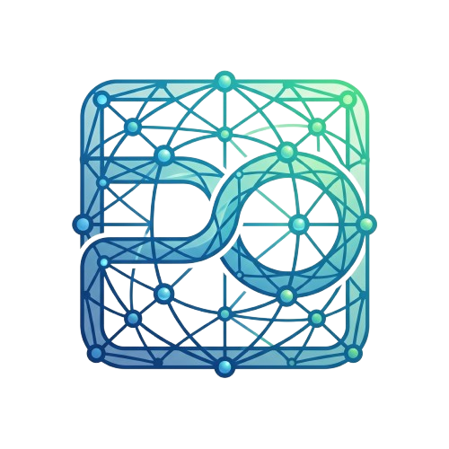

<div align="center">



# UHQ Panel OS

**Le panel open source et auto-hébergé pour gérer, surveiller et revendre vos proxies.**

[](https://github.com/BloumeSAS/UHQ-Panel-OS/releases/latest)
[](https://github.com/BloumeSAS/UHQ-Panel-OS/actions/workflows/ci-cd.yml)
[](https://hub.docker.com/r/bloumesas/uhq-panel-os)
[](LICENSE)
[](https://uhq-panel-os-docs.bloume.fr)

[Documentation](https://uhq-panel-os-docs.bloume.fr) · [Présentation vidéo](https://youtu.be/UUASI5vbf2Q) · [Guide d'installation](https://youtu.be/bF2yE-W-93s) · [Changelog](CHANGELOG.md) · [Sécurité](SECURITY.md)

[🇬🇧 English](README.md) · 🇫🇷 Français

</div>

---

## Présentation

UHQ Panel OS est une plateforme complète pour les opérateurs de proxies. Une seule image Docker contient :

- une **API REST NestJS** (`api/`) avec PostgreSQL via Prisma,
- un **panel d'administration React / Vite / Tailwind** (`web/`),
- un **moteur proxy TCP** intégré (HTTP + CONNECT, port `990` et ports dédiés),
- un **système d'addons** pour étendre le panel sans toucher à son cœur.

Le projet est développé et maintenu par [Bloume SAS](https://bloume.fr), sponsorisé par [UHQ.Monster](https://uhq.monster), sous licence MIT.

## Fonctionnalités

| Domaine | Ce que vous obtenez |
|---|---|
| **Tableau de bord en direct** | Threads, sessions, comptes actifs, état du pool et trafic du jour en WebSocket |
| **Comptes proxy** | Quotas, limites de débit et de threads, expiration, filtres par pays, IP autorisées, ports dédiés |
| **Pool et catégories** | Scraper (sources personnalisées + IA), checker, import manuel, fallback par catégorie, multiplicateurs de trafic |
| **VPN dans les pools** | OpenVPN, WireGuard et liens V2Ray (VLESS, VMess, Trojan, Shadowsocks, Hysteria 2) comme sorties |
| **Sécurité** | 2FA, IP bannies avec bannissement automatique et liste blanche, anti-VPN, limites de débit, journal d'audit |
| **Exploitation** | Sauvegardes (locales / S3), restauration depuis `/setup`, diagnostic, alertes (Discord, Slack, e-mail), mise à jour en un clic |
| **Prise en main** | Assistant d'installation, jeton d'installation, visite guidée, données de démo, page de statut publique |
| **Langues** | Français et anglais, pour le panel et l'API |

## Addons officiels (gratuits)

| Addon | Rôle | Vidéo |
|---|---|---|
| [Wallet](https://github.com/BloumeSAS/UHQ-Addon-Wallet) | Solde par compte, recharge en ligne, codes cadeau | [▶](https://youtu.be/TxrwwHY6CKM) |
| [Orders](https://github.com/BloumeSAS/UHQ-Addon-Orders) | Boutique intégrée, vente au Go, Stripe / PayPal / crypto, livraison automatique | [▶](https://youtu.be/YRiaL9PhQ5o) |
| [Analytics](https://github.com/BloumeSAS/UHQ-Addon-Analytics) | Statistiques détaillées et constats automatiques | [▶](https://youtu.be/VW0lURoUj3g) |
| [Codes promo](https://github.com/BloumeSAS/UHQ-Addon-PromoCodes) | Codes cadeau, bonus de recharge, réductions | [▶](https://youtu.be/9MhQMgCrrvI) |
| [UHQ.Monster Reseller](https://github.com/BloumeSAS/UHQ-Addon-Reseller) | Achat de proxies UHQ.Monster depuis le panel | [▶](https://youtu.be/MPDvjlLr3l4) |
| [Vitrine](https://github.com/BloumeSAS/UHQ-Addon-Vitrine) | Page d'accueil publique pour les visiteurs | [▶](https://youtu.be/1bPm8wEvaCQ) |
| [Tickets](https://github.com/BloumeSAS/UHQ-Addon-Tickets) | Support client : pièces jointes, console du personnel, notation | [▶](https://youtu.be/1_OG1qAr-N4) |
| [Parrainage](https://github.com/BloumeSAS/UHQ-Addon-Referral) | Liens de parrainage, commissions versées sur le Wallet | [▶](https://youtu.be/15SLX4HXQwE) |
| [Statut](https://github.com/BloumeSAS/UHQ-Addon-Status) | Page de statut publique, détection automatique des pannes et redéploiements | [▶](https://youtu.be/nTGtTSsZQOA) |
| [Sécurité](https://github.com/BloumeSAS/UHQ-Addon-Security) | Empreinte d'appareil (BloumeID) sur connexion, inscription et mot de passe oublié | [▶](https://youtu.be/kQJuCGh7cV8) |

Tous les addons officiels sont inclus dans l'image et s'activent en un clic depuis **Extensions**. Pour créer le vôtre, voir la [documentation des addons](https://uhq-panel-os-docs.bloume.fr/addons/overview).

## Démarrage rapide

### Docker Compose (recommandé)

```bash
git clone https://github.com/BloumeSAS/UHQ-Panel-OS.git
cd UHQ-Panel-OS
docker compose up -d --build
docker compose logs app | grep "TOKEN"   # jeton d'installation
```

Ouvrez le panel et suivez l'assistant. PostgreSQL est embarqué, le secret JWT est généré au premier démarrage. En local sans reverse proxy, décommentez le port `8000:8000` dans `docker-compose.yml`.

### Image prête à l'emploi

Images publiées pour `linux/amd64` et `linux/arm64` :

| Registre | Image |
|---|---|
| Docker Hub | [`bloumesas/uhq-panel-os`](https://hub.docker.com/r/bloumesas/uhq-panel-os) |
| GitHub Container Registry | `ghcr.io/bloumesas/uhq-panel-os` |

Tags : `latest`, `main`, `X.Y.Z`, `X.Y`. Dans `docker-compose.yml`, remplacez le bloc `build:` du service `app` par `image: bloumesas/uhq-panel-os:latest`.

### Coolify

Créez une ressource **Docker Compose** pointant vers ce dépôt, indiquez votre domaine, déployez. Le port `990` (proxy TCP) est publié directement sur l'hôte. Guide complet : [installation](https://uhq-panel-os-docs.bloume.fr/guide/installation).

### Ports et DNS

| Port | Usage |
|---|---|
| `8000` | Panel + API (derrière Traefik / votre reverse proxy) |
| `990` | Moteur proxy TCP |
| `9000-9250` | Ports dédiés (catégories / comptes) |

Cloudflare ne proxifie pas le TCP brut : placez le panel sur un enregistrement en nuage orange (`panel.exemple.fr`) et le proxy sur un enregistrement en nuage gris (`prx.exemple.fr`), puis renseignez **Paramètres → publicProxyHost**.

## Développement

Prérequis : Node.js 20+, PostgreSQL.

```bash
cd api && npm install && npm run start:dev   # API :8000 + proxy :990
cd web && npm install && npm run dev         # Vite :5173
```

| Chemin | Contenu |
|---|---|
| `api/` | API NestJS, schéma Prisma, moteur proxy |
| `web/` | Panel React |
| `addons/addons.json` | Registre des addons officiels (inclus au build) |

## Documentation

Tout est sur **[uhq-panel-os-docs.bloume.fr](https://uhq-panel-os-docs.bloume.fr)** : installation, configuration, référence API, développement d'addons, chaque addon avec sa vidéo. Sources : [UHQ-Panel-OS-Docs](https://github.com/BloumeSAS/UHQ-Panel-OS-Docs).

## Contribuer

Issues et pull requests bienvenues. Lisez [CONTRIBUTING.md](CONTRIBUTING.md) et le [code de conduite](CODE_OF_CONDUCT.md).

## Sécurité

Ne publiez **pas** de faille dans une issue publique. Voir [SECURITY.md](SECURITY.md).

## Licence

[MIT](LICENSE) © [Bloume SAS](https://bloume.fr). Sponsorisé par [UHQ.Monster](https://uhq.monster).
