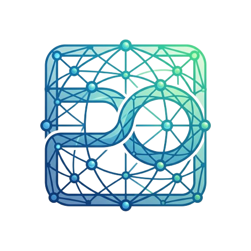

<div align="center">



# UHQ Panel OS

**The open-source, self-hosted panel to manage, monitor and resell proxies.**

[](https://github.com/BloumeSAS/UHQ-Panel-OS/releases/latest)
[](https://github.com/BloumeSAS/UHQ-Panel-OS/actions/workflows/ci-cd.yml)
[](https://hub.docker.com/r/bloumesas/uhq-panel-os)
[](LICENSE)
[](https://uhq-panel-os-docs.bloume.fr)

[Documentation](https://uhq-panel-os-docs.bloume.fr) · [Video tour](https://youtu.be/UUASI5vbf2Q) · [Install guide](https://youtu.be/bF2yE-W-93s) · [Changelog](CHANGELOG.md) · [Security](SECURITY.md)

🇬🇧 English · [🇫🇷 Français](README.fr.md)

</div>

---

## Overview

UHQ Panel OS is a complete platform for proxy operators. A single Docker image ships:

- a **NestJS REST API** (`api/`) with PostgreSQL through Prisma,
- a modern **React / Vite / Tailwind admin panel** (`web/`),
- a built-in **TCP proxy engine** (HTTP + CONNECT, port `990` and dedicated ports),
- an **add-on system** to extend the panel without touching its core.

It is built and maintained by [Bloume SAS](https://bloume.fr), sponsored by [UHQ.Monster](https://uhq.monster), and released under the MIT license.

## Features

| Area | What you get |
|---|---|
| **Live dashboard** | Threads, sessions, active accounts, pool health and today's traffic over WebSocket |
| **Proxy accounts** | Quotas, bandwidth limits, thread limits, expiry, country filters, IP allow-lists, dedicated ports |
| **Pool & categories** | Scraper (custom sources + AI), checker, manual import, per-category fallback, traffic multipliers |
| **VPN in pools** | OpenVPN, WireGuard and V2Ray links (VLESS, VMess, Trojan, Shadowsocks, Hysteria 2) turned into exits |
| **Security** | 2FA, IP bans with automatic bans and an allow-list, anti-VPN, rate limits, audit log |
| **Operations** | Backups (local / S3), restore from `/setup`, diagnostics, alerts (Discord, Slack, e-mail), one-click updates |
| **Onboarding** | Setup wizard, installation token, guided tour, demo data, public status page |
| **i18n** | French and English, for the panel and the API |

## Official add-ons (free)

| Add-on | Purpose | Video |
|---|---|---|
| [Wallet](https://github.com/BloumeSAS/UHQ-Addon-Wallet) | Balance per account, online top-ups, gift codes | [▶](https://youtu.be/TxrwwHY6CKM) |
| [Orders](https://github.com/BloumeSAS/UHQ-Addon-Orders) | Built-in shop, pay-per-GB, Stripe / PayPal / crypto, automatic delivery | [▶](https://youtu.be/YRiaL9PhQ5o) |
| [Analytics](https://github.com/BloumeSAS/UHQ-Addon-Analytics) | Detailed statistics and automatic findings | [▶](https://youtu.be/VW0lURoUj3g) |
| [Promo Codes](https://github.com/BloumeSAS/UHQ-Addon-PromoCodes) | Gift codes, top-up bonuses, shop discounts | [▶](https://youtu.be/9MhQMgCrrvI) |
| [UHQ.Monster Reseller](https://github.com/BloumeSAS/UHQ-Addon-Reseller) | Buy UHQ.Monster proxies from the panel | [▶](https://youtu.be/MPDvjlLr3l4) |
| [Vitrine](https://github.com/BloumeSAS/UHQ-Addon-Vitrine) | Public landing page for visitors | [▶](https://youtu.be/1bPm8wEvaCQ) |
| [Tickets](https://github.com/BloumeSAS/UHQ-Addon-Tickets) | Customer support with attachments, staff console, ratings | [▶](https://youtu.be/1_OG1qAr-N4) |
| [Referral](https://github.com/BloumeSAS/UHQ-Addon-Referral) | Referral links, commissions paid to the Wallet | [▶](https://youtu.be/15SLX4HXQwE) |
| [Status](https://github.com/BloumeSAS/UHQ-Addon-Status) | Public status page, automatic outage and redeploy detection | [▶](https://youtu.be/nTGtTSsZQOA) |

All official add-ons are bundled in the image and enabled in one click from **Extensions**. See the [add-on documentation](https://uhq-panel-os-docs.bloume.fr/addons/overview) to build your own.

## Quick start

### Docker Compose (recommended)

```bash
git clone https://github.com/BloumeSAS/UHQ-Panel-OS.git
cd UHQ-Panel-OS
docker compose up -d --build
docker compose logs app | grep "TOKEN"   # installation token
```

Open the panel and follow the setup wizard. PostgreSQL is embedded, the JWT secret is generated on first boot. For local use without a reverse proxy, uncomment the `8000:8000` port mapping in `docker-compose.yml`.

### Prebuilt image

Images are published for `linux/amd64` and `linux/arm64`:

| Registry | Image |
|---|---|
| Docker Hub | [`bloumesas/uhq-panel-os`](https://hub.docker.com/r/bloumesas/uhq-panel-os) |
| GitHub Container Registry | `ghcr.io/bloumesas/uhq-panel-os` |

Tags: `latest`, `main`, `X.Y.Z`, `X.Y`. In `docker-compose.yml`, replace the `build:` block of the `app` service with `image: bloumesas/uhq-panel-os:latest`.

### Coolify

Create a **Docker Compose** resource pointing at this repository, set your domain, deploy. Port `990` (TCP proxy) is published directly on the host. Full guide: [installation](https://uhq-panel-os-docs.bloume.fr/guide/installation).

### Ports and DNS

| Port | Usage |
|---|---|
| `8000` | Panel + API (behind Traefik / your reverse proxy) |
| `990` | TCP proxy engine |
| `9000-9250` | Dedicated ports (categories / accounts) |

Cloudflare cannot proxy raw TCP: put the panel on an orange-cloud record (`panel.example.com`) and the proxy on a grey-cloud record (`prx.example.com`), then set **Settings → publicProxyHost**.

## Development

Requirements: Node.js 20+, PostgreSQL.

```bash
cd api && npm install && npm run start:dev   # API :8000 + proxy :990
cd web && npm install && npm run dev         # Vite :5173
```

| Path | Content |
|---|---|
| `api/` | NestJS API, Prisma schema, proxy engine |
| `web/` | React panel |
| `addons/addons.json` | Official add-on registry (bundled at build time) |

## Documentation

Everything is on **[uhq-panel-os-docs.bloume.fr](https://uhq-panel-os-docs.bloume.fr)**: installation, configuration, API reference, add-on development, every add-on with its video. Source: [UHQ-Panel-OS-Docs](https://github.com/BloumeSAS/UHQ-Panel-OS-Docs).

## Contributing

Issues and pull requests are welcome. Please read [CONTRIBUTING.md](CONTRIBUTING.md) and the [Code of Conduct](CODE_OF_CONDUCT.md).

## Security

Please **do not** open a public issue for a vulnerability. See [SECURITY.md](SECURITY.md).

## License

[MIT](LICENSE) © [Bloume SAS](https://bloume.fr). Sponsored by [UHQ.Monster](https://uhq.monster).
